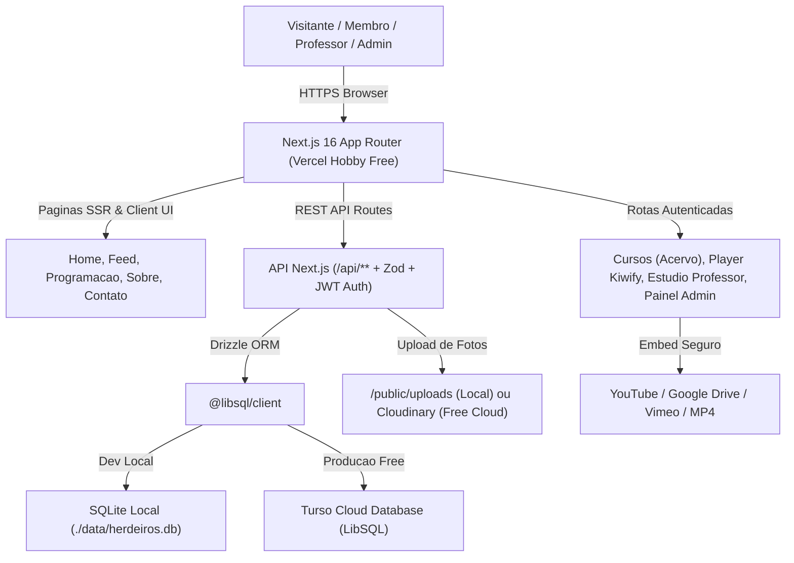
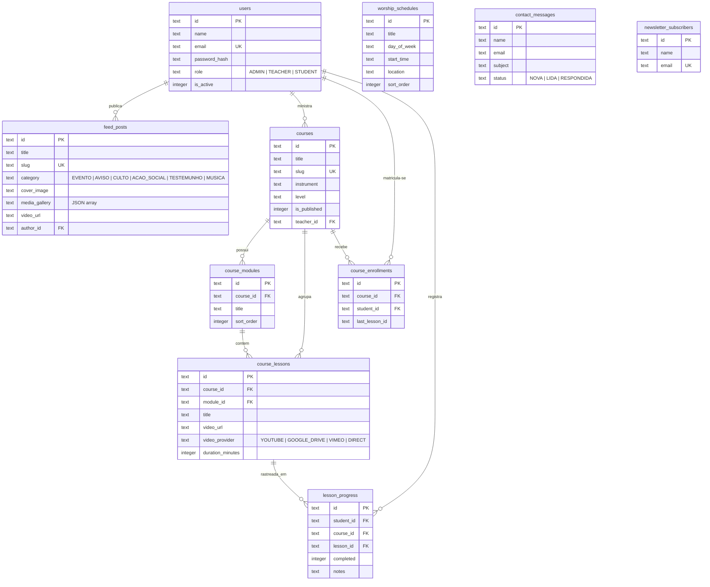
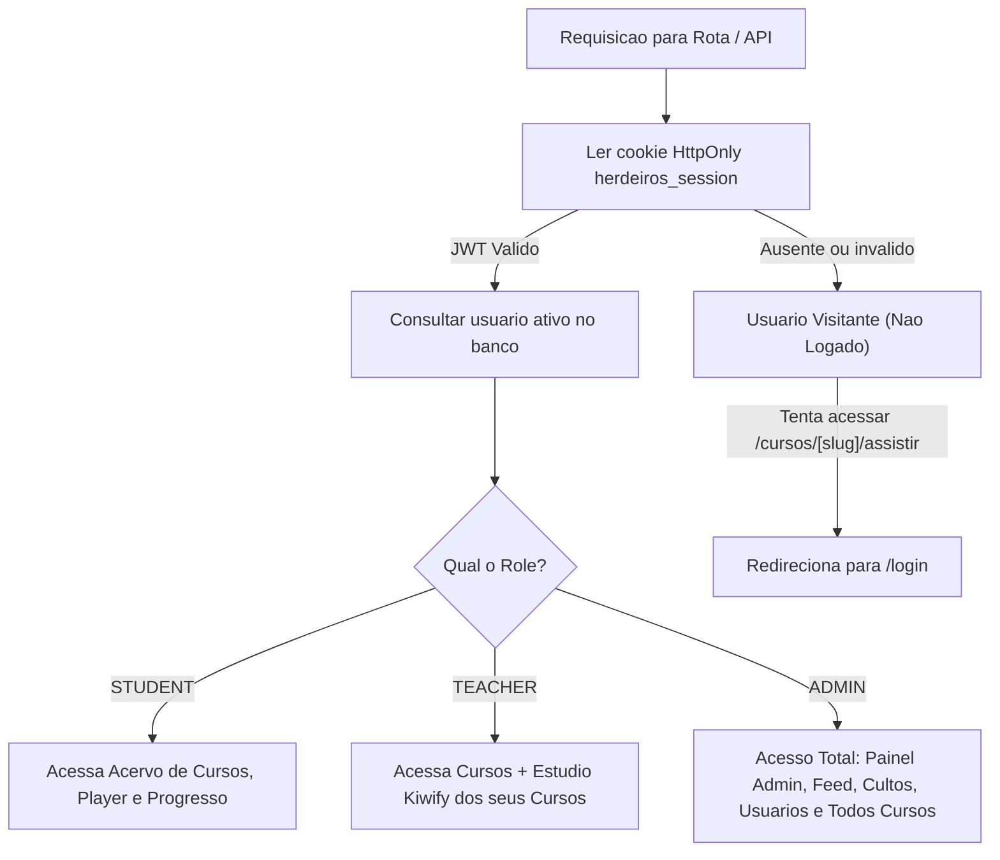
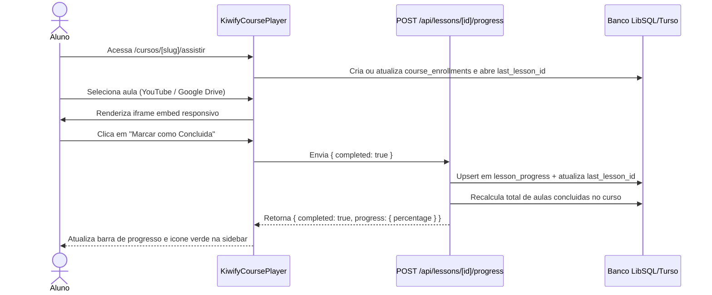

# 📐 Diagramas do Sistema

Este documento apresenta os diagramas arquiteturais, modelagem de dados e fluxos operacionais da plataforma da **Igreja Bíblica Herdeiros de Deus**.

---

## 1. Diagrama de Arquitetura Geral

---

## 2. Diagrama Entidade-Relacionamento (Banco de Dados)

---

## 3. Fluxo de Autenticação e Controle de Acesso (RBAC)

---

## 4. Fluxo do Player e Progresso de Aulas (Estilo Kiwify)

